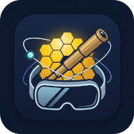

# Exposição Virtual de Instrumentos Astronômicos



Exposição virtual interativa em Realidade Virtual (RV) de instrumentos astronômicos históricos, voltada a óculos de Realidade Virtual. Esta exposição usa as tecnologias de software (WebXR/Three.js/A-Frame) em hardware de *Head-Mounted Display* (HMD).

<br clear="left"/>


## 1. Sobre a Exposição

A **Exposição Virtual de Instrumentos Astronômicos** é uma iniciativa de divulgação científica e extensão universitária desenvolvida pelo grupo [ObseRVe/UFSCar](https://observe.ufscar.br/) no âmbito do edital **CNPq 2022** (processo 407086/2022-6). Seu objetivo principal é promover o acesso a tecnologias inovadoras de divulgação de astronomia, transportando o visitante por mais de quatro séculos de inovações tecnológicas que revolucionaram a compreensão humana sobre o cosmos.

Por milênios, a humanidade contemplou a abóbada celeste restrita às observações a olho nu. Em 1609, a adaptação pioneira de uma luneta para fins astronômicos inaugurou uma nova era: a ciência moderna deixava de ser apenas especulativa para tornar-se observacional e experimental. Esta exposição constrói uma jornada cronológica imersiva que parte das primeiras lentes de Galileu Galilei no século XVII e alcança os complexos observatórios espaciais infravermelhos e sondas interestelares do século XXI.

### Objetivos da Exposição

A visita à exposição virtual foi desenhada para ir além da contemplação passiva, oferecendo uma experiência ativa e multissensorial:

1. **Evolução Científica e Histórica:** Observar os saltos conceituais e tecnológicos da astronomia instrumental, desde a transição dos refratores ópticos para os grandes refletores de espelho metálico, a conquista da exploração do Sistema Solar por robôs e sondas, até a superação da atmosfera terrestre com observatórios espaciais orbitais.
2. **Manipulação Tátil Direta (*Hand Tracking*):** Utilizando o rastreamento nativo das mãos (sem necessidade de controles manuais) no dispositivo de RV ou a interação via mouse/toque no navegador, o visitante é incentivado a segurar, rotacionar e inspecionar cada instrumento no pedestal central de cada sala. Isso permite apreciar detalhes construtivos minúsculos (o acabamento em couro da luneta de Galileu, as polias e engrenagens do cavalete de Herschel, ou os braços robóticos dos rovers marcianos).
3. **Percepção de Escala (*Fullscale*):** Nas salas com grandes telescópios e sondas, além da miniatura manipulável de mesa, o visitante depara-se com réplicas tridimensionais em escala real (1:1) suspensas ou posicionadas no ambiente, proporcionando a noção exata de monumentalidade de instrumentos que operam no espaço sideral ou na superfície de Marte.
4. **Multissensorialidade e Acessibilidade:** Cada ambiente conta com uma ambientação acústica cuidadosamente selecionada, alternando entre obras sacras e clássicas contemporâneas a cada época e sonificações de dados de radiofrequência espacial. Todos os painéis contam com narrações em áudio acionadas por toque, permitindo uma experiência acessível e fluida.
5. **Independência de Conexão (Inclusão Digital):** O projeto foi arquitetado sob a filosofia *Offline-First*, garantindo que a exposição possa ser instalada e operada de forma autônoma em escolas, feiras de ciências e planetários, mesmo em locais sem qualquer acesso à internet ou rede local.

---

### Visão Geral dos Conteúdos das Salas

A exposição é estruturada em um átrio central distribuidor e seis salas temáticas dispostas em ordem cronológica:

```
[Hall de Entrada]
       │
       ├─── Sala 1: A Luneta de Galileu (1609)
       ├─── Sala 2: O Telescópio de 7 Pés de William Herschel (1781)
       ├─── Sala 3: As Sondas Voyager (1977)
       ├─── Sala 4: O Telescópio Espacial Hubble (1990)
       ├─── Sala 5: Os Rovers Marcianos -- Curiosity (1997)
       └─── Sala 6: O Telescópio Espacial James Webb (2021)
```

* **Hall de Entrada:** Ponto de entrada sob um ambiente instigante de arcos rochosos. Apresenta um painel introdutório com audiodescrição e seis tótens circulares de teletransporte que permitem ao visitante escolher livremente seu ponto de partida ou navegar de forma cronológica pela história dos instrumentos.
* **Sala 1: A Luneta de Galileu (1609):** Ambientada em um ambiente renascentista de pedra. Explora a luneta refratora de 21 vezes de aumento de Galileu Galilei, sua contextualização histórica com o Santo Ofício, as gravuras originais do livro *Sidereus Nuncius* (1610) que revelaram as crateras lunares e a descoberta das quatro maiores luas de Júpiter, refutando o geocentrismo.
* **Sala 2: O Telescópio de 7 Pés de William Herschel (1781):** Destaca o refletor newtoniano de espéculo metálico com distância focal de 2,1 metros, com o qual Herschel descobriu o planeta Urano e as luas Titânia e Oberon. Aborda a colaboração fundamental de sua irmã Caroline Herschel nos cálculos matemáticos, na moldagem dos espelhos ópticos e na elaboração do primeiro mapa tridimensional da Via Láctea.
* **Sala 3: As Sondas Voyager (1977):** Transporta o usuário para o espaço profundo em direção à heliopausa. Exibe a arquitetura das sondas Voyager 1 e 2, o famoso *Disco de Ouro* (*Golden Record*) com a mensagem terrestre a civilizações futuras, a fotografia histórica da Terra como um *Pálido Ponto Azul* imortalizada por Carl Sagan, o *Grand Tour* dos planetas exteriores e o vídeo com a trajetória orbital completa da missão interestelar.
* **Sala 4: O Telescópio Espacial Hubble (1990):** Posicionada na órbita terrestre, exibe o telescópio espacial em miniatura e em escala real. Documenta o drama óptico da aberração esférica e seu histórico reparo em órbita na missão STS-61 (módulo COSTAR), os icônicos *Pilares da Criação*, as observações do *Hubble Deep Field* (revelando milhares de galáxias primitivas em uma fração do espaço vazio aparente) e o impacto do cometa Shoemaker-Levy 9 em Júpiter.
* **Sala 5: Os Rovers Marcianos -- Curiosity (1997-presente):** Situada sobre o solo e sob o céu alaranjado da Cratera Gale em Marte. Trata da evolução da exploração robótica de superfície desde o pequeno *Sojourner* (com destaque para a participação da engenheira brasileira Jacqueline Lyra na missão), os autorretratos e furos de sondagem do *Curiosity* revelando moléculas orgânicas inéditas em leitos de lagos antigos, e o voo atmosférico pioneiro do helicóptero *Ingenuity*.
* **Sala 6: O Telescópio Espacial James Webb (2021):** Localizada a 1,5 milhão de quilômetros da Terra, ao redor do ponto de equilíbrio gravitacional L2 de Lagrange. Apresenta o telescópio de espelhos hexagonais de berílio revestidos de ouro e escudo solar, suas observações pioneiras no infravermelho de galáxias primordiais como a MoM-z14 (280 milhões de anos pós-Big Bang), a detecção pioneira de dióxido de carbono e de enxofre em exoplanetas (WASP-39 b) e a revelação do campo profundo SMACS 0723.

---

## 2. Origem dos Assets e Créditos

Todos os modelos tridimensionais, registros fotográficos históricos, trilhas musicais, sonificações e texturas de materiais da exposição foram reunidos sob critérios de curadoria acadêmica e licenciamento aberto (Domínio Público, Creative Commons ou CC0). 

Para viabilizar a fluidez da expeirência imersiva e tempos viáveis de carregamento em dispositivos RV como o Meta Quest 2 (e similares) e navegadores móveis, todos os recursos digitais (*assets*) passaram por otimização: compressão geométrica de malhas com Draco/Meshopt, texturas em formato moderno WebP com limites de resolução controlados e taxas de amostragem de áudio calibradas.

### Créditos e Atribuições Detalhadas por Sala

#### Sala 1: A Luneta de Galileu
* **Modelo 3D:** *Luneta de Galileu Galilei* (`galileo_telescope_LR.glb`) -- Desenvolvido por João Teles de Carvalho Neto (2026) -- [CC-BY-SA-4.0](https://creativecommons.org/licenses/by-sa/4.0/).
* **Trilha Sonora:** *Miserere Mei, Deus* (Gregorio Allegri, 1638) -- [Ensamble Escénico Vocal](https://commons.wikimedia.org/wiki/File:Allegri_-_Miserere_Mei,_Deus_-_Ensamble_Esc%C3%A9nico_Vocal_(audio).ogg) (Catedral de Tlaxcala, 2021) -- [CC-BY-3.0](https://creativecommons.org/licenses/by-3.0/).
* **Painel 1:** *Luneta original de Galileu Galilei (Inv. 2428)* (`luneta-inv2428.webp`) -- Foto por Zdenek Kratochvil (2022), acervo Museo Galileo / [Wikimedia Commons](https://commons.wikimedia.org) -- [CC-BY-SA-4.0](https://creativecommons.org/licenses/by-sa/4.0/).
* **Painel 2:** *Retrato de Galileu Galilei* (`Portrait_of_Galileo_Galilei.webp`) -- Pintura por Justus Sustermans (c. 1640), acervo National Maritime Museum, Greenwich / [Wikimedia Commons](https://commons.wikimedia.org) -- Domínio Público.
* **Painel 3:** *Galileu Diante do Santo Ofício* (`Galileo_before_the_Holy_Office.webp`) -- Pintura por Joseph-Nicolas Robert-Fleury (1847), acervo Museu do Louvre / [Wikimedia Commons](https://commons.wikimedia.org) -- Domínio Público.
* **Painel 4:** *Páginas 18 e 49 de Sidereus Nuncius* (`sidereusnuncius_p18_49.webp`) -- Obra original de Galileu Galilei (Veneza, 1610) / [Wikimedia Commons](https://commons.wikimedia.org) -- Domínio Público.
* **Referências:**
  * Science Museum Group: [Telescope by Galileo (replica)](https://collection.sciencemuseumgroup.org.uk/objects/co56202/telescope-by-galileo-replica)
  * Royal Museums Greenwich: [Galileo telescope replica](https://www.rmg.co.uk/collections/objects/rmgc-object-14174)
  * Obras originais de Galileu Galilei:
    * GALILEI, Galileo. *Sidereus Nuncius* (O Mensageiro das Estrelas). Veneza: Thomas Baglioni, 1610. Disponível no [Internet Archive](https://archive.org/details/sidereusnunciusm00gali_0/page/n1/mode/2up).
    * GALILEI, Galileo. *Dialogo di Galileo Galilei Linceo... sopra i due massimi sistemi del mondo tolemaico, e copernicano* (Diálogo sobre os dois máximos sistemas do mundo). Florença: Giovanni Battista Landini, 1632.

#### Sala 2: O Telescópio de 7 Pés de William Herschel
* **Modelo 3D:** *Telescópio Refletor Newtoniano de 7 pés* (`herschel7feet_LR.glb`) -- Desenvolvido por João Teles de Carvalho Neto (2026) -- [CC-BY-SA-4.0](https://creativecommons.org/licenses/by-sa/4.0/).
* **Trilha Sonora:** *Flute Concerto in G major - 3. Presto* (C. P. E. Bach, 1755) -- [Advent Chamber Orchestra](https://commons.wikimedia.org/wiki/File:Carl_Philipp_Emanuel_Bach_-_Flute_Concerto_in_G_major,_Wq._169_-_3._Presto.ogg) com Constance Schoepflin (flauta) -- [CC-BY-SA-2.0](https://creativecommons.org/licenses/by-sa/2.0/).
* **Painel 1:** *Réplica do Telescópio de 7 pés de Herschel* (`Herschel_7ft_Telescope.webp`) -- Museu de Astronomia Herschel (Bath, 1981) / Foto por Mike Peel / [Wikimedia Commons](https://commons.wikimedia.org) -- [CC-BY-SA-4.0](https://creativecommons.org/licenses/by-sa/4.0/).
* **Painel 2:** *William e Caroline Herschel* (`William_and_Caroline_Herschel_LR.webp`) -- Litografia por A. Diethe (c. 1896), acervo Wellcome Collection, Londres / [Wikimedia Commons](https://commons.wikimedia.org) -- [CC-BY-4.0](https://creativecommons.org/licenses/by-4.0/) / Domínio Público.
* **Painel 3:** *A Descoberta de Urano e suas Luas* (`Urano_Titania_Oberon.webp`) -- Simulação via Stellarium e observação do telescópio Hubble / NASA, ESA, STScI -- Domínio Público.
* **Painel 4:** *Espelho de Espéculo Metálico de 10 pés* (`Primary_mirror_10ft.webp`) -- Foto do espelho de Herschel (c. 1783), Mathematisch-Physikalischer Salon, Dresden / [Wikimedia Commons](https://commons.wikimedia.org) -- Domínio Público.
* **Painel 5:** *Primeiro Mapa Tridimensional da Via Láctea* (`via_lactea.webp`) -- Mapeamento por William Herschel (1785, Domínio Público) e panorama pelo observatório Gaia / ESA, Gaia, DPAC -- [CC-BY-SA-3.0 IGO](https://creativecommons.org/licenses/by-sa/3.0/igo/).
* **Referências:**
  * Herschel Museum of Astronomy (Bath, UK): [herschelmuseum.org.uk](https://herschelmuseum.org.uk/)
  * Science Museum Group: [Herschel 7-foot Newtonian reflector](https://collection.sciencemuseumgroup.org.uk/objects/co8413200/herschel-7-foot-telescope-replica-telescope)
  * Royal Museums Greenwich: [William Herschel's 7-foot telescope](https://www.rmg.co.uk/collections/objects/rmgc-object-11002)
  * NASA Science / Hubble Mission: [240 Years Ago: Astronomer William Herschel Identifies Uranus as the Seventh Planet](https://science.nasa.gov/missions/hubble/240-years-ago-astronomer-william-herschel-identifies-uranus-as-the-seventh-planet/)
  * Obras originais de William e Caroline Herschel:
    * HERSCHEL, William. "Account of a Comet. By Mr. Herschel, F. R. S.; Communicated by Dr. Watson, Jun. of Bath, F. R. S.". *Philosophical Transactions of the Royal Society of London*, vol. 71, 1781, pp. 492--501. (Descoberta de Urano).
    * HERSCHEL, William. "On the Construction of the Heavens. By William Herschel, Esq. F. R. S.". *Philosophical Transactions of the Royal Society of London*, vol. 75, 1785, pp. 213--266. (Mapeamento da Via Láctea).
    * HERSCHEL, William. "An Account of the Discovery of Two Satellites Revolving Round the Georgian Planet". *Philosophical Transactions of the Royal Society of London*, vol. 77, 1787, pp. 125--129. (Descoberta de Titânia e Oberon).
    * HERSCHEL, Caroline. *Memoirs and Correspondence of Caroline Herschel*. Ed. Mrs. John Herschel. Londres: John Murray, 1876.
    * HERSCHEL, Caroline. *Catalogue of Stars: taken from Mr. Flamsteed's Observations contained in the second volume of the Historia Coelestis and not inserted in the British Catalogue*. Londres: Royal Society of London / Peter Elmsly, 1798.
    * HERSCHEL, Caroline. "An Account of a New Comet. In a Letter from Miss Caroline Herschel to Mr. Charles Blagden, M. D. Sec. R. S.". *Philosophical Transactions of the Royal Society of London*, vol. 77, 1787, pp. 1--3.

#### Sala 3: As Sondas Voyager
* **Modelo 3D:** *Sonda Espacial Voyager* (`voyager_LR.glb`) -- National Aeronautics and Space Administration / [NASA 3D Resources Hub](https://nasa.gov) -- Domínio Público.
* **Trilha Sonora:** *Gymnopédie No. 1* (Erik Satie, 1888) -- Arranjo e execução por [Kevin MacLeod](https://commons.wikimedia.org/wiki/File:Kevin_MacLeod_-_Erik_Satie_Gymnopedie_No_1.ogg) (2011) -- [CC-BY-3.0](https://creativecommons.org/licenses/by-3.0/).
* **Painel 1:** *O Disco de Ouro (Golden Record)* (`golden_disks.webp`) -- Registro oficial do disco fonográfico das naves Voyager (1977), NASA / JPL-Caltech -- Domínio Público.
* **Painel 2:** *O Pálido Ponto Azul (Pale Blue Dot)* (`pale-blue-dot-revised.webp`) -- Fotografia da Terra a 6 bilhões de km pela Voyager 1 (1990), NASA / JPL-Caltech -- Domínio Público.
* **Painel 3:** *O Grand Tour dos Planetas Gigantes* (`Voyager_probes_with_the_outer_worlds.webp`) -- Pintura em acrílico por Don Davis (c. 1980s), acervo NASA / JPL-Caltech -- Domínio Público.
* **Painel 4:** *Cruzando a Heliopausa* (`Heliosphere-Chart.webp`) -- Diagrama de posições interestelares PIA22835, NASA / JPL-Caltech -- Domínio Público.
* **Painel 5 (Vídeo):** *Trajetória da Voyager 1 pelo Sistema Solar* (`Voyager1SpedUp.mp4`) -- Animação orbital, NASA Scientific Visualization Studio (SVS ID: 4139, 2017) -- Domínio Público.
* **Referências:**
  * Royal Museums Greenwich: [Model of Voyager spacecraft](https://www.rmg.co.uk/collections/objects/rmgc-object-11122)
  * NASA Science: [Voyager 1's Pale Blue Dot](https://science.nasa.gov/mission/voyager/voyager-1s-pale-blue-dot/)
  * The Planetary Society: [Pale Blue Dot](https://www.planetary.org/worlds/pale-blue-dot/)

#### Sala 4: O Telescópio Espacial Hubble
* **Modelo 3D:** *Hubble Space Telescope (HST)* (`hubble_LR.glb`) -- NASA / [NASA 3D Resources Hub](https://nasa.gov) -- Domínio Público.
* **Trilha Sonora:** *The Planets, Op. 32: VII. Neptune, the Mystic* (Gustav Holst, 1916) -- Execução por [United States Marine Band](https://commons.wikimedia.org) -- Domínio Público.
* **Painel 1:** *Hubble Deep Field (1995)* (`HubbleDeepField.800px.webp`) -- Imagem histórica de campo profundo, Robert Williams / NASA, ESA, STScI (1996) -- Domínio Público.
* **Painel 2:** *Os Pilares da Criação* (`Eagle_nebula_pillars.webp`) -- Nebulosa da Águia (M16), Jeff Hester e Paul Scowen (ASU) / NASA (1995) -- Domínio Público.
* **Painel 3:** *A Miopia do Hubble e a Correção Óptica* (`hubble_optical_correction.webp`) -- Instalação do módulo COSTAR na missão STS-61 e galáxia M100, NASA (1993) -- Domínio Público.
* **Painel 4:** *Colisão do Cometa Shoemaker-Levy 9 com Júpiter* (`Shoemaker-Levy_collision.webp`) -- Impactos na atmosfera joviana, H. Hammel (MIT) e NASA (1994) -- Domínio Público.
* **Referências:**
  * NASA Science: [Hubble Space Telescope 3D Model](https://science.nasa.gov/resource/hubble-space-telescope-3d-model-2/)
  * NASA Science: [Hubble's Mirror Flaw & Optical Repair](https://science.nasa.gov/mission/hubble/observatory/design/optics/hubbles-mirror-flaw/)
  * NASA Science: [Comet Shoemaker-Levy's First Fragment Impacts with Jupiter](https://science.nasa.gov/asset/hubble/comet-shoemaker-levys-first-fragment-impacts-with-jupiter/)

#### Sala 5: Os Rovers Marcianos (Curiosity)
* **Modelo 3D:** *Curiosity Rover (Mars Science Laboratory)* (`curiosity_LR.glb`) -- NASA / [NASA 3D Resources Hub](https://nasa.gov) -- Domínio Público.
* **Trilha Sonora:** *Boléro* (Maurice Ravel, 1928) -- Berlin Symphonic Orchestra sob regência de Ferenc Fricsay (1956) / [Affordance.info](http://affordance.typepad.com//mon_weblog/2016/05/cher-maurice-ravel.html) / [Wikimedia Commons](https://commons.wikimedia.org) -- Domínio Público.
* **Painel 1:** *Sojourner -- O Primeiro Rover* (`Sojourner.webp`) -- Fotografia em solo marciano pelo módulo Mars Pathfinder (1997), NASA / JPL-Caltech -- Domínio Público.
* **Painel 2:** *Autorretrato do Curiosity* (`Curiosity_SelfPortrait.webp`) -- Mosaico na Cratera Gale no sítio "Big Sky" (2015), NASA / JPL-Caltech / MSSS -- Domínio Público.
* **Painel 3:** *Ingenuity e o Primeiro Voo em Outro Planeta* (`Ingenuity.webp`) -- Registro pela câmera Mastcam-Z do rover Perseverance (2023), NASA / JPL-Caltech / ASU / Simeon Schmauß -- Domínio Público.
* **Painel 4:** *Moléculas Orgânicas Inéditas em Marte* (`e2-curiosity-drill-holes-at-mary-anning-pia24173.webp`) -- Furos de amostragem no ponto "Mary Anning 3" (PIA24173, 2020), NASA / JPL-Caltech / MSSS -- Domínio Público.
* **Referências:**
  * NASA Science: [NASA's Curiosity Finds Organic Molecules Never Seen Before on Mars](https://www.nasa.gov/missions/mars-science-laboratory/curiosity-rover/nasas-curiosity-finds-organic-molecules-never-seen-before-on-mars/)
  * Revista Galileu: [Conheça Jacqueline Lyra, engenheira espacial brasileira que trabalha na NASA](https://revistagalileu.globo.com/Ciencia/Espaco/noticia/2019/08/conheca-jacqueline-lyra-engenheira-espacial-brasileira-que-trabalha-na-nasa.html)

#### Sala 6: O Telescópio Espacial James Webb
* **Modelo 3D:** *James Webb Space Telescope (JWST)* (`jwst_LR.glb`) -- NASA / [NASA 3D Resources Hub](https://nasa.gov) -- Domínio Público.
* **Trilha Sonora:** *Sonificações de Dados e Imagens do JWST* (`webb_audios.mp3`) -- NASA, ESA, CSA, STScI e projeto SYSTEM Sounds / [NASA Webb Sonifications](https://science.nasa.gov/mission/webb/sonifications/) -- Domínio Público.
* **Painel 1:** *SMACS 0723 -- O Primeiro Campo Profundo* (`SMACS0723.webp`) -- Aglomerado de galáxias no infravermelho próximo (2022), NASA, ESA, CSA, STScI -- Domínio Público.
* **Painel 2:** *Os Pilares da Criação em Infravermelho* (`pillars_of_creation_webb_and_hubble_LR.webp`) -- Comparação visual entre Hubble e James Webb, NASA, ESA, CSA, STScI -- Domínio Público.
* **Painel 3:** *Atmosfera do Exoplaneta WASP-39 b* (`WASP-39b_atmosphere.webp`) -- Espectro de transmissão atmosférica revelando água e CO2 (2022), NASA, ESA, CSA, STScI -- Domínio Público.
* **Painel 4:** *A Galáxia MoM-z14 na Fronteira Cósmica* (`COSMOS_Field_MoM-z14_Galaxy_LR.webp`) -- Galáxia a z=14 observada por NIRCam/NIRSpec (2026), NASA, ESA, CSA, STScI -- Domínio Público.
* **Painel 5 (Vídeo):** *O Movimento Orbital do Webb no Ponto L2* (`Animation_Of_Webb_Orbit_LR.webm`) -- Animação da órbita de halo em L2 (2021), NASA / GSFC -- Domínio Público.
* **Referências:**
  * NASA Science: [Webb's First Deep Field (NIRCam Image) -- SMACS 0723](https://science.nasa.gov/asset/webb/webbs-first-deep-field-nircam-image/)
  * NASA Science: [Pillars of Creation (Hubble and Webb Images Side-by-Side)](https://science.nasa.gov/asset/webb/pillars-of-creation-hubble-and-webb-images-side-by-side/)
  * NASA Science: [COSMOS Field MoM-z14 Galaxy NIRCam Image](https://science.nasa.gov/asset/webb/cosmos-field-mom-z14-galaxy-nircam-image/)
  * NASA Science: [Exoplanet WASP-39 b Transmission Spectra](https://science.nasa.gov/asset/webb/exoplanet-wasp-39-b-transmission-spectra/)

#### Cenário e Arquitetura Virtual (Compartilhado)
* **Texturas PBR de Superfície:** Parede de pedra (`plaster_stone_wall_02_diff_4k.webp`), piso cerâmico (`slab_tiles_diff_2k.webp`), reboco (`plastered_wall_diff_2k.webp`) e tijolos medievais (`medieval_red_brick_diff_2k.webp`) -- [Poly Haven](https://polyhaven.com) -- [CC0 1.0 (Domínio Público)](https://creativecommons.org/publicdomain/zero/1.0/).
* **Molduras 3D Decorativas:** Molduras clássicas ornamentadas (`fancy_picture_frame_01_4k` e `fancy_picture_frame_02_4k`) -- [Poly Haven](https://polyhaven.com) -- [CC0 1.0 (Domínio Público)](https://creativecommons.org/publicdomain/zero/1.0/).
* **Panoramas de Fundo (Skyboxes):** Céu diurno claro (`kloppenheim_06_puresky.webp`) por [Poly Haven](https://polyhaven.com) (CC0 1.0); Mapa celeste de estrelas em 4K (`starmap_2020_4k.webp`) por NASA Scientific Visualization Studio (Domínio Público).

---

### Otimização e Tratamento de Recursos

Para garantir taxas de quadros fluidas em WebXR e minimizar o consumo de banda e armazenamento, foram aplicados os seguintes procedimentos técnicos:

#### Compressão de modelos 3D (glTF / GLB)
Os modelos 3D originais foram simplificados e comprimidos com o utilitário `gltf-transform`:
```sh
gltf-transform optimize entrada.glb saida.glb --compress meshopt --texture-compress webp --texture-size 1024
```

#### Gravação local e ajuste de áudios
Para registrar trilhas sonoras ou amostras sonoras de execução local no navegador com taxa de bits otimizada:
```sh
sudo apt install -y pulseaudio-utils
```
Identificar o fluxo de áudio ativo:
```sh
pactl list short sources | grep monitor
```
Gravar com o `ffmpeg` convertendo em MP3 leve:
```sh
ffmpeg -f pulse -i <identificador_do_sink_monitor> -acodec libmp3lame -ab 96k gravacao_audio.mp3
```

---

## 3. Procedimentos Técnicos de Desenvolvimento e Deploy

Para desenvolvimento e manutenção desta exposição, o projeto conta com três modos distintos de execução, testes e distribuição final. 

O suporte a **PWA / Service Worker (Offline-First)** é ativado exclusivamente na versão publicada no GitHub Pages (`*.github.io`). Nos modos de desenvolvimento local (Wi-Fi e Cabo USB), o Service Worker permanece automaticamente desativado para garantir carregamento instantâneo das alterações no código e permitir a depuração com o A-Frame Inspector (<kbd>Ctrl</kbd> + <kbd>Alt</kbd> + <kbd>I</kbd>) sem retenção de cache.

---

### 3.1 Modo de Desenvolvimento Wi-Fi (Sem cabo / HTTPS Local)

É o fluxo mais rápido e direto para desenvolvimento e testes interativos sem necessidade de cabos:

* **Contexto Seguro (HTTPS):** A especificação WebXR exige contexto seguro (HTTPS) para habilitar o modo imersivo VR e o rastreamento das mãos ao acessar pela rede local (IP).
* **Geração dos Certificados:** Como o repositório não guarda as chaves por segurança (diretório `cert/` ignorado no `.gitignore`), elas precisam ser geradas apenas uma vez:
  ```sh
  ./gencert.sh
  ```
  *(Necessita do pacote `mkcert`: `sudo apt install mkcert`)*

* **Iniciar o Servidor:**
  ```sh
  node server.js
  ```
* **Acesso nos Óculos:** Estando na **mesma rede Wi-Fi** do computador, abra o navegador do Meta Quest e acesse o endereço HTTPS exibido no terminal.
  *(Na primeira abertura, aceite o aviso de certificado auto-assinado em "Avançado -> Continuar para o site")*.
* **Laptop em Modo Hotspot (Sem internet / Sem roteador externo):**
  Como todos os recursos e bibliotecas JavaScript são locais (sem dependências de CDN externa), o próprio laptop pode atuar como ponto de acesso Wi-Fi (Hotspot) mesmo sem conexão externa à internet. Estão disponíveis scripts utilitários:
  ```sh
  ./iniciar_hotspot.sh   # Ativa o Hotspot do laptop e inicia o node server.js
  ./desligar_hotspot.sh  # Desativa o Hotspot ao concluir
  ```
* **Sem PWA:** Neste modo o Service Worker fica desativado. Qualquer alteração no código é refletida imediatamente ao recarregar a página.

---

### 3.2 Modo de Deploy Local com Cabo (USB / adb / HTTP Simples)

Usado para testes locais com conexão por fio e caches sob demanda, sem a necessidade de certificados SSL:

* **Requisitos:**
  1. Meta Quest com **Modo Desenvolvedor** habilitado (via app Meta Horizon no smartphone).
  2. Cabo USB conectado ao computador com autorização de depuração USB concedida dentro do visor.
  3. Ferramenta `adb` instalada no PC (`sudo apt install adb`).
* **Iniciar o Servidor em modo HTTP:**
  ```sh
  node server.js --http
  ```
  *(Caso não existam certificados na pasta `cert/`, o `node server.js` iniciará automaticamente em modo HTTP simples)*
* **Redirecionar a porta via adb:**
  ```sh
  adb reverse tcp:8080 tcp:8080
  ```
* **Acesso nos Óculos:** No navegador do Meta Quest, acesse diretamente:
  ```
  http://localhost:8080
  ```
  *(O Chromium / Meta Quest Browser reconhece `localhost` como origem segura mesmo sobre HTTP comum, permitindo o WebXR sem certificados).*
* **Comportamento do Cache e Funcionamento Offline neste modo:**
  * Neste modo **não há PWA nem Service Worker ativo**.
  * **O cache dos arquivos depende de visitar as salas:** Como o pré-carregamento automático do Service Worker não roda, o navegador do Meta Quest só baixa os assets de cada sala (modelos 3D `.glb`, texturas, áudios e vídeos) sob demanda no momento em que a sala é visitada e seus templates são instanciados no DOM.
  * **Persistência do Cache em disco:** Ao visitar todas as salas conectado pelo cabo, o Meta Quest Browser grava permanentemente todos os arquivos em seu cache de disco. Após esse procedimento, **o cabo e a internet podem ser desconectados**: mesmo reiniciando ou desligando os óculos, ao abrir `http://localhost:8080` a aplicação funcionará 100% offline.
  * **Atenção:** O cache só será sobrescrito ou perdido caso outro projeto diferente seja servido no mesmo endereço (`localhost:8080`) ou caso os dados de navegação/cache do navegador sejam limpos manualmente.

---

### 3.3 Modo Deploy GitHub Pages (Padrão de Produção / PWA 100% Offline)

Modo padrão do repositório para distribuição final e uso autônomo sem fios nem servidores locais:

* **Zero Configuração:** Não exige cabos, certificados ou comandos de terminal no dispositivo do usuário. Basta sincronizar a versão com o repositório remoto:
  ```sh
  git push origin main
  ```
  A aplicação estará disponível em `https://<usuario>.github.io/<repositorio>/`.
* **PWA com Precache Dinâmico por Varredura de Templates:**
  1. **Ativação Exclusiva:** O Service Worker (`sw.js`) é ativado exclusivamente quando a aplicação está hospedada no GitHub Pages (`*.github.io`).
  2. **Download Silencioso:** Na primeira visita com conexão à internet, a aplicação varre automaticamente as tags `<template>` de todas as 6 salas e solicita ao Service Worker o pré-carregamento de todos os ~90 MB de assets para o `CacheStorage`.
  3. **Instalação Nativa:** O usuário pode clicar no menu do Meta Quest Browser e selecionar **Instalar Aplicativo**, criando um atalho direto na biblioteca do Quest.
  4. **Atualizações de Versão:** Ao publicar uma nova versão com atualização do nome do cache em `sw.js` (ex.: `v1` -> `v2`), o Service Worker detecta as alterações na próxima conexão, sincroniza os novos arquivos e subsitui versões antigas.
  5. **Funcionamento 100% Offline:** Uma vez completada a sincronização, os óculos podem ser desconectados da internet e a exposição funcionará perfeitamente offline, com acesso irrestrito a todas as salas, modelos 3D, áudios e vídeos.

---

## 4. Licença

* **Código-Fonte do Projeto:** Licenciado sob a [Licença MIT](LICENSE) (HTML, JavaScript da aplicação, CSS, shaders e infraestrutura).
* **Bibliotecas de Terceiros (`libs/`):** As bibliotecas A-Frame, A-Frame Extras, Troika Text, A-Frame Environment Component e Meshopt Decoder são de autoria de seus respectivos criadores e distribuídas sob suas próprias licenças de código aberto (predominantemente Licença MIT).
* **Modelos 3D Autorais:** O modelo 3D do Telescópio de Herschel ([`assets/Telescopio_Herschel`](assets/Telescopio_Herschel/LICENSE.md)) e da Luneta de Galileu ([`assets/Luneta_Galileu`](assets/Luneta_Galileu/LICENSE.md)), desenvolvidos por João Teles de Carvalho Neto, são distribuídos sob a licença [Creative Commons Atribuição-CompartilhaIgual 4.0 Internacional (CC BY-SA 4.0)](https://creativecommons.org/licenses/by-sa/4.0/).
* **Assets Multimídia de Terceiros:** Imagens, sons e modelos da NASA, ESA e acervos de museus seguem seus respectivos termos de Domínio Público ou Creative Commons detalhados na seção [Créditos e Atribuições](#créditos-e-atribuições-detalhadas-por-sala).

---

*A curadoria desta exposição é de autoria exclusiva dos desenvolvedores humanos. Ferramentas de Inteligência Artificial foram utilizadas no apoio ao desenvolvimento dos códigos, confecção deste arquivo de README e ícone de identificação do aplicativo.*